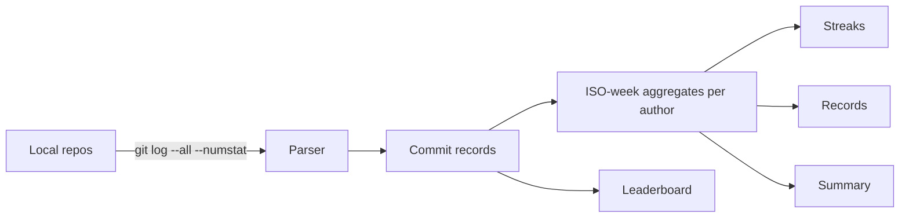

# Architecture — shipstreak

## 1. Scope
A training log for builders: weekly shipping stats, streaks, records, leaderboards, kudos from git history.
**MVP:** `git log --numstat` parser (custom record separator), ship classification (Conventional
`feat/fix/perf`, PR merges, tags), ISO-week aggregation, streaks, personal records, leaderboard,
weekly summary, JSON kudos store.
**Product:** GitHub/GitLab OAuth, deploy events as ships, clubs and challenges, shareable cards.

## 2. Data flow

## 3. Design decisions
- **Ships, not lines of code.** Leaderboards rank by ships, then active days. LOC rewards the
  wrong behaviour.
- **A record separator (`\x1e`) + tab-delimited header** makes the parser robust to subjects
  containing any printable character.
- **Current streak tolerates the in-progress week.** If you shipped last week and haven't yet this
  week, the streak is still alive, which matches how Strava treats the current period.
- **UTC `Z` normalisation** before `fromisoformat`. git prints `Z` for UTC, and Python 3.10 rejects
  it (a regression test covers this; CI caught it).
- **Local-only by default.** It reads git on your machine and only aggregates would ever be uploaded.

## 4. Production architecture
A CLI/agent posts weekly aggregates (not code) to an API. Postgres (users, clubs, weeks). OAuth
integrations for remote repos and deploy providers (Vercel, Fly). A card renderer (OG images).

## 5. Risks
Gaming via trivial `feat:` commits. Weight ships by diff size bands and deploy evidence, and
clubs can choose their scoring rules.

## 6. Limitations (sell-ready audit, 2026-10-28)
- No feature gating by plan: every API key unlocks the same software. Team and
  Community pricing is support and onboarding, not gated features; hackathons,
  cohorts as software, public leaderboards, and branding are roadmap, not shipped,
  and were removed from sales copy.
- Team's per-member price is not enforced: Stripe checkout sells one key per
  subscription and does not count members.
- The hosted API cannot read local git repos: it works from `shipstreak export`
  files uploaded by the customer (the CLI's `export` command is deliberately not
  exposed by the API). A buyer who expects the web app to connect directly to
  their repos will need the OAuth integration from the roadmap.
- Docker build and a live Render/Fly deployment were not verified in the audit
  environment (no Docker binary there); Dockerfile, render.yaml, and fly.toml are
  the same template shape as vibe-lube, but a deployment claim remains
  "not verified" until one is made.
- Stripe prices were not verified against a live Stripe account in this run;
  checkout and revocation are covered in tests with mocked Stripe calls, and the
  README example now uses builder/team/community plan keys to match the plan names.
